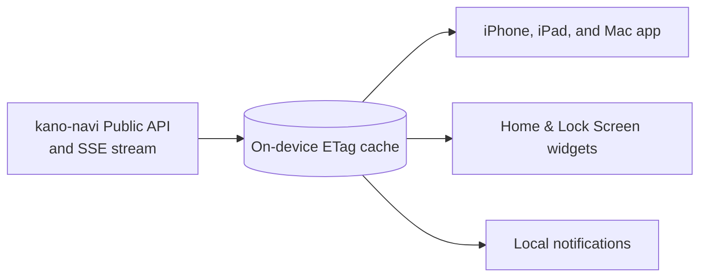

<h1 align="center">Kano Navi for iOS and macOS</h1>

<p align="center">
  <b>Kano Mahoro's next stream, schedule, posts, and journey on iPhone, iPad, and Mac.</b><br>
  An unofficial fan app powered by the Kano Navi public board.
</p>

Kano Navi for iOS and macOS brings the public activity of **Kano Mahoro
(鹿乃まほろ)** to Apple platforms: what airs next, the monthly schedule,
recent posts and videos, her journey since 2010, her discography, an archive of
her 2015–2019 LINE BLOG, Home Screen and Lock Screen widgets, and on-device
notifications. It supports English, Japanese, and Simplified Chinese across
light and dark appearances.


<p align="center"><sub>Screenshots of the live board, captured November 16, 2026 at
20:30–20:48 JST. The app's content follows the board and changes as new
streams and posts arrive.</sub></p>

> [!NOTE]
> Kano Navi is an independent fan project with no official affiliation or
> endorsement. Original announcements always take precedence; see the
> [Disclaimer](#disclaimer).

## Features

<table>
  <tr>
    <td width="50%" valign="top">
      <h3>⏰ Now</h3>
      Spotlight ticket for the live or next stream with a countdown, Coming Up
      entries across the next two weeks, active sales, and collection freshness.
    </td>
    <td width="50%" valign="top">
      <h3>📅 Schedule</h3>
      Monday-first program guide in List, Compact, Stacked, and Details modes,
      entry detail sheets, and calendar subscription links.
    </td>
  </tr>
  <tr>
    <td width="50%" valign="top">
      <h3>💬 Posts</h3>
      Post timeline from X and bilibili with account filters, a month jump
      grid, images, quoted posts, and in-place translations.
    </td>
    <td width="50%" valign="top">
      <h3>🎬 Videos</h3>
      On Air streams and dated videos with kind and platform filters, month
      jump, availability marks, and alternate platform links.
    </td>
  </tr>
  <tr>
    <td width="50%" valign="top">
      <h3>🌱 Journey</h3>
      Milestones since 2010 and a visual archive with branch and category
      filters, source credits, and a zoomable image viewer.
    </td>
    <td width="50%" valign="top">
      <h3>💿 Works &amp; LINE BLOG</h3>
      Releases with edition details and store links, featured works, searchable
      song uploads, and the restored 2015–2019 LINE BLOG with photos and videos.
    </td>
  </tr>
  <tr>
    <td width="50%" valign="top">
      <h3>🧩 Widgets</h3>
      Upcoming widgets for the Home Screen, macOS desktop, and Lock Screen with
      per-widget content language and deep links into Schedule.
    </td>
    <td width="50%" valign="top">
      <h3>🔔 On-device Alerts &amp; Languages</h3>
      Local notifications and timed reminders with no login or remote push,
      plus separate interface and content language settings.
    </td>
  </tr>
</table>

The [User guide](docs/user/index.md) describes every screen and widget.

## How It Works

The app reads the public API of the
[`kano-navi`](https://github.com/yexca/kano-navi) service, caches snapshots on
device with ETags so launch screens and widgets render immediately, and keeps
the last saved copy visible when the service cannot be reached. See
[How it works](docs/how-it-works.md).



## Build and Test

Requires Xcode 27 or later, iOS 26+, and macOS 26+. See
[Local development](docs/development/local-dev.md) and the
[agent guide](AGENTS.md) before making changes.

```bash
# Fast format, doc-link, tool tests, and sensitive-information checks
make ci-fast

# Shared package tests
make test-package

# App, widget, and UI tests on iOS Simulator
make test-ios

# Native macOS app, widget, and unit tests
make test-mac
```

Releases ship as unsigned IPAs for iPhone and iPad and an ad-hoc-signed `.app`
for macOS; see
[Commit and release](docs/development/commit-and-release.md#release-distribution).

## Documentation

- [User guide](docs/user/index.md): screens, widgets, notifications, and
  settings.
- [How it works](docs/how-it-works.md) and
  [Architecture](docs/architecture/index.md): data flow, modules, API contract,
  and system boundaries.
- [Development](docs/development/index.md): local setup, design, testing,
  security, commits, and releases.
- [Security](SECURITY.md), including how to report a vulnerability.
- [Release history](docs/history/index.md): release notes and unreleased
  changes.
- [Documentation index](docs/README.md): every document in the repository.

## Disclaimer

- Kano Navi is an independent fan project. It is not affiliated with or
  endorsed by Kano Mahoro, her agency, X, YouTube, bilibili, or LINE.
- Every post, video, event, and archive record links to its original public
  page, which is always authoritative.
- Artwork, artist names, and other third-party content keep their original
  rights; the code license does not grant rights to them.

## License

Created by [yexca](https://github.com/yexca). Kano Navi for iOS and macOS is
free software licensed under the
[GNU Affero General Public License v3.0](LICENSE).
