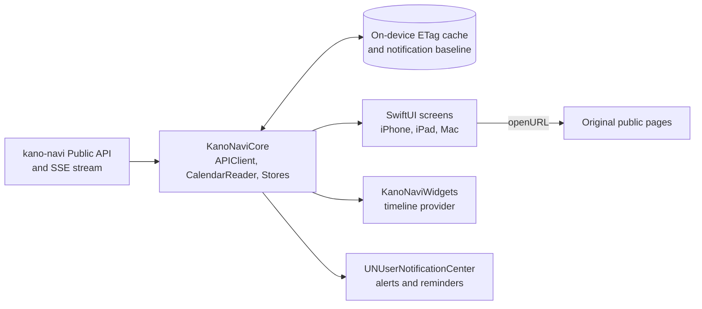

# How It Works

Kano Navi for iOS and macOS is an unofficial status board app for Kano Mahoro
fans on iPhone, iPad, and Mac. What visitors see is described in the
[User guide](user/index.md); this page explains how the app works with the
[`kano-navi`](https://github.com/yexca/kano-navi) service and what it
deliberately does not do.

## Goals

- Answer "is she live, what is next, and when" at a glance on the Now screen
  and in Home Screen and Lock Screen widgets.
- Render server decisions (`projection` and `view` objects) rather than
  re-deriving schedules, focus order, or status on the device.
- Keep the last good data visible on screen and in widgets when the network or
  service is unavailable, alongside a short status notice.
- Show event times in `Asia/Tokyo` (JST) and use Japan dates for calendar days
  and "today".
- Keep every post, video, event, and archive item traceable to its original
  public page.

## Non-goals

- Do not fetch X, YouTube, Bilibili, LINE BLOG captures, shops, or model
  providers directly from the app; the app reads only the Kano Navi public API
  and the media URLs it returns.
- Do not include operator console (`/admin`) or MCP control tools.
- Do not require account login, remote push servers, analytics, or third-party
  SDKs.
- Do not present fan-maintained material as official announcements; original
  platform pages remain authoritative.

## Data Flow

1. The app reads the configured HTTPS origin of `kano-navi` through
   `KanoNaviCore`'s `APIClient`, sending `If-None-Match` with stored ETags.
2. On launch, launch-visible screens and widgets draw cached JSON snapshots on
   their first frame and revalidate in the background. When the service cannot
   be reached, cached data stays on screen with its saved JST timestamp.
3. While a scene is active, `DashboardStore` subscribes to the dashboard SSE
   revision stream (falling back to 30-second revision polling on repeated
   errors or HTTP 503), revalidates once a minute, and reloads at
   `projection.nextTransitionAt`.
4. Media files are loaded from the same service origin through
   `MediaImageLoader`, resized via the service's `w` query parameter, decoded
   off the main actor, and cached on disk and in memory. External provenance
   links open in the system browser through `openURL` without being fetched by
   the app.
5. When notifications are enabled, background refresh tasks and foreground
   snapshots update the on-device baseline in `FileNotificationStateStore` and
   schedule local alerts and upcoming calendar reminders through
   `UNUserNotificationCenter`.

See [Core boundaries](architecture/core-boundaries.md) for the full architectural
contract.

## Known Limits

- Freshness depends on the `kano-navi` service's own collection schedule; the
  app cannot recover data that the service has not collected.
- Widgets and on-device reminders run without an App Group or remote push
  server, so widgets read `/api/calendar` into their own container cache and
  notifications refresh only when background tasks or active scenes run.
- On-device background refresh timing is controlled by iOS (`BGAppRefreshTask`)
  and macOS (`NSBackgroundActivityScheduler` while the app is running).
- Release builds are unsigned IPAs on iOS/iPadOS and an ad-hoc-signed `.app` on
  macOS without an Apple Developer team or provisioning profile.

## Maintainer Decision Rule

When a new requirement conflicts with "the server decides, the app renders,"
"old data survives a failure," or "no direct external scraping," preserve those
properties first and propose any missing API fields in `kano-navi` before
changing the app.

## Related Docs

- [Architecture](architecture/index.md)
- [Design](development/design.md)
- [Local development](development/local-dev.md)
- [Documentation index](README.md)
